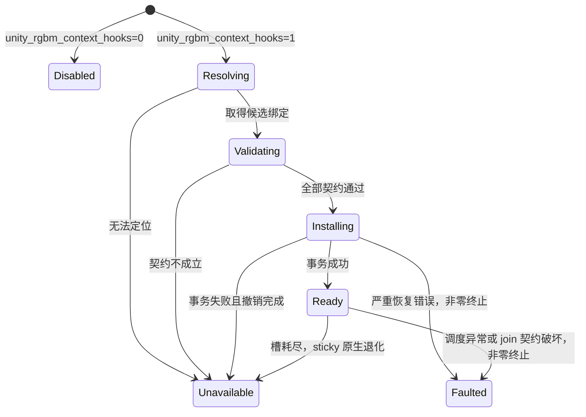

# Feature 设计：RGBM Hook 跨 Unity 小版本定位

- Feature ID：`rgbm-hook-portability`
- 建立日期：2026-10-09（Asia/Shanghai）
- 状态：P0–P6 已完成，v0.5.0 已发布；实测支持 Windows x64 f1／f2，边界见 P5／P6；无 VS 测试按用户要求取消
- 源码基线：`7cd4ded`，配置缓存并发修复已提交
- 配套文档：[施工记录](rgbm-hook-portability-construction.md)
- P0 结论：[接口差异、回调作用域及依赖路线](rgbm-hook-portability-interface.md)
- P1 交付：[认证、扫描、缓存及 f2 活体验证](rgbm-hook-portability-cache.md)
- P3 交付：[运行时、编码退化和故障退出](rgbm-hook-portability-runtime.md)
- P4 记录：[Editor／Worker 与部署](rgbm-hook-portability-deployment.md)
- P5 交付：[跨版本编码验收](rgbm-hook-portability-acceptance.md)
- P6 交付：[v0.5.0 发行验收](rgbm-hook-portability-release.md)
- 部署整理：绑定准备已合入 `hook_loader.cs`；原生 DLL 合并另记为 [TODO feature](rgbm-hook-dll-consolidation-design.md)

## 1. 要解决的问题

设计基线中的插件把 RGBM 上下文的三个 Unity 私有函数地址写死为 2022.3.62f1 的 RVA，再比较入口的 12／15 字节。打包机使用 2022.3.62f2，三个指纹均不匹配，因而没有建立 RGBM 上下文。普通 BC7 编码 Hook 与 RGBM 上下文 Hook 是两层不同的功能。

目标是把“为每个小版本填写地址表”改为“从当前二进制定位函数，确认接口兼容后安装 Hook”。地址移动和入口指令变化不应单独成为拒绝支持小版本的原因；函数签名、结构布局或 RGBM 语义发生变化时，仍必须停止自动安装。

本 feature 不采用删除 `memcmp` 后继续使用旧 RVA 的办法，也不承诺任意 Unity 版本均可自动兼容。

## 2. 设计时实现基线与证据

| 位置 | 已确认行为 | 本 feature 的处理 |
| --- | --- | --- |
| `src/bc7_hook_dll.cpp` 的 `kUnity*Rva` | 三个在用入口为 `0x1EDC1A0`、`0x1ED6540`、`0x1ED9710` | 改为运行时绑定结果；旧 RVA 仅作为测试对照 |
| `install_unity_inline_detour` | 原样复制固定长度入口，再写绝对跳转；没有通用指令重定位 | 交给成熟 Detour 实现 |
| `install_unity_rgbm_context_hooks_impl` | 分别安装三个 Hook，可出现部分安装成功 | 全量预检、事务安装、失败撤销 |
| `unity_compress_single_image_texture_hook` | 第三个参数提供 `TextureUsageMode` | 继续使用 Unity 原生语义，校验参数契约 |
| `unity_bc7_threaded_process_hook` / `unity_bc7_job_lambda_hook` | 从 `job_data + 0x08` 取源像素地址，以活跃集合关联 RGBM，再恢复 Worker TLS | 以作用域 callback 包装替代字段读取和 lambda Hook |
| `is_rgbm_usage_mode` | 使用 `0x224` 位图判定枚举 2／5／9 | 纳入语义契约验证，不默认为所有版本一致 |
| `tools/symbolize_unity.cpp` | 已能查询函数、公有符号和类型；DIA 路径写死为开发机 VS 目录，使用未验证的 `loadDataFromPdb` | 可复用查询思路，不能原样作为部署组件 |
| `src/editor_plugin/hook_loader.cs` | 主进程加载 DLL，并注入 AssetImportWorker | 主进程准备绑定缓存，Worker 读取并自行验证 |
| `src/rdo_common.h` | 设计调查时曾观察到撤回修复的工作区；施工时复核已与 `7cd4ded` 安全实现一致 | 施工基线已核对，无需覆盖现有源码 |

当前注释仍描述早期 `ConvertImageToRGBM` 像素追踪方案，文件里也保留了未安装的转换 Hook 和标记容器。施工时应区分在用链路与遗留实验，验证替代链路后再清理。

本地 2022.3.62f1 的实际二进制身份：

```text
ProductVersion = 2022.3.62f1_4af31df58517
SHA256 = E564374ACF68AD36EC7383D6B423EA3862F9280A3A1A61E34B997E694567F0DF
PE TimeDateStamp = 0x68121E0A
SizeOfImage = 0x4F42000
```

官方 2022.3.62f2 changeset 为 `7670c08855a9`。施工时用户补充本机 f2 路径，已读取其 exe／匹配 PDB 身份，详见施工记录 R07；它不自动代表远端打包机的实际 exe。[官方发布信息](https://unity.com/releases/editor/whats-new/2022.3.62f2)

## 3. 范围与交付边界

首批验收覆盖 Windows x64 的 2022.3.62f1 与 2022.3.62f2；中国版或其他 revision 必须按实际 exe 独立核对。两个版本必须使用同一份插件构建产物，不靠切换版本专用 DLL。

本次施工包含 PDB 定位、受限特征扫描后备、兼容性验证、Detour 后端、上下文关联重构、绑定缓存、主进程／Worker 初始化和验收工具。

不改变 Oodle／ERT 编码算法、RDO 强度数值和纹理资源绑定方式；不建立纹理资产分类清单；不把 Unity.exe、Unity PDB 或 Oodle 专有 DLL 纳入仓库或 release。本 feature 首先改造 RGBM 私有入口，普通 `bc7elib_compress_blocks` 导出 Hook 的整体重构不属于本次目标。

## 4. 主要设计决定

### 4.1 定位入口：匹配 PDB 优先，扫描作为后备

新增独立的只读解析工具，输入实际 `Unity.exe` 与符号搜索目录，输出机器生成的绑定缓存和诊断报告。

1. 读取 PE／CodeView 信息，获取架构、映像尺寸、PDB GUID／Age 与 exe SHA256。
2. 用 `loadDataForExe`，或从 PE 提取 GUID／Age 后调用 `loadAndValidateDataFromPdb`。不以 PDB 文件名相同作为匹配条件。
3. 同时查询 `SymTagFunction` 和 `SymTagPublicSymbol`；公有符号可能没有长度和完整类型信息，应分别标记证据质量。
4. 用函数语义、所属类型／编译单元和调用关系定位目标。BC7 lambda 不能依赖 `lambda_ea38...` 这种编译器生成哈希名称保持不变。
5. 将候选 RVA 映射回 exe 代码，验证唯一性、边界、调用关系及接口契约。

现有本地 PDB 查询曾无法直接解析 `CompressSingleImageTexture` 的函数记录，因此“PDB 存在”不等于“三个入口必定能按名称找到”。应允许公有符号、调用关系和扫描补充缺失证据。[DIA 的 exe 关联加载](https://learn.microsoft.com/en-us/visualstudio/debugger/debug-interface-access/idiadatasource-loaddataforexe?view=visualstudio)、[GUID／Age 校验](https://learn.microsoft.com/en-us/visualstudio/debugger/debug-interface-access/idiadatasource-loadandvalidatedatafrompdb?view=visualstudio)

扫描只在 PE 可执行代码段内进行，使用允许位移／地址变化的特征及函数调用关系，并复用同一套接口验证。候选为零或多于一个、接口证据不足时拒绝安装；禁止只靠通用的寄存器保存 prologue 确认函数。错误 PDB 不得作为扫描的语义依据。

### 4.2 地址和接口分别验证

绑定结果必须区分：

| 验证层 | 要证明的内容 | 不能由什么替代 |
| --- | --- | --- |
| 二进制身份 | 当前 exe、匹配 PDB、缓存属于同一映像 | Unity 版本字符串 |
| 入口定位 | 找到目标函数且候选唯一、RVA 位于代码段 | 泛化的入口字节模式 |
| 调用契约 | 参数数量／类型、x64 传参方式、返回值和实际调用点一致 | 正确的函数地址 |
| 数据与语义 | RGBM usage 判定、Job 调度／回调关系和必要字段有效 | Detour 安装成功 |
| 行为 | RGBM 走独立参数，普通 RGBA 不被误分类 | 日志里只有 `installed` |

兼容描述按实际接口形态建立，不按每个小版本列 RVA。满足既有接口形态和验证规则的新二进制可生成自己的地址绑定；未知接口形态必须补证据或新增实现。PDB 缺少参数／类型时，只能使用已验证的接口规则和充分的调用点证据，不能默认它与 f1 相同。

### 4.3 跳板后端：优先采用 Microsoft Detours

采用锁定版本／commit 的 Detours，静态链接进独立的安装协调 DLL，保留许可证。由后端处理指令边界、复制／重定位和跳板，不再使用固定 12／15 字节复制作为通用实现。P2 采用同目录无 CRT gate DLL 的初始化回调阻止新线程开始执行，并对既有线程登记；恢复边界、驻留策略和证据见 [P2 报告](rgbm-hook-portability-detours.md)。

通过薄封装提供 `prepare`、`commit`、`rollback`；接口描述指定的全部必需 Hook 在一个事务中安装。P0 选定的首个接口需要压缩入口与 BC7 process 两个 Hook。施工记录应补充选定依赖的实际版本、commit、许可证位置和构建参数。

事务还需要正确处理可能执行目标代码的线程；只登记初始化线程不能作为并发安全的验收依据。必须验证线程枚举、生命周期竞争和事务失败恢复。Detours 不会自动确认 Unity 私有函数的调用签名，也不会自动验证 `JobData` 布局。[Detours 使用说明](https://github.com/microsoft/Detours/wiki/Using-Detours)、[许可证](https://github.com/microsoft/Detours/blob/main/LICENSE.md)

### 4.4 上下文关联：作用域 callback 包装

保持 `CompressSingleImageTexture` 提供 RGBM usage、Job Worker 最终取得该语义的链路。

P0 已证明两版 process 把输入 JobData 复制到自身栈上再调度，对象指针身份方案不成立。首个接口采用 `unity.threaded-copy-for-each-callback.v1`：在 process Hook 捕获调用线程的语义 TLS，把三参数 callback 替换为预编译包装函数，通过包装函数身份关联本次作用域。

包装器只透传不透明 JobData 和 begin／end，不读取 `0x08` 或其他源像素字段；Worker 临时恢复作用域状态并调用原 callback。原 process 正常返回前通过 fence 等待任务完成，再释放关联槽。上下文应支持非 RGBM 任务、并发调度、嵌套调用、地址复用和作用域退出后的清理，不能让旧任务标记污染新任务。

上下文使用 `Unknown`／`Ordinary`／`RGBM` 三态。非 RGBM 调度也必须登记明确的普通纹理上下文；缺少记录、关联失败或无有效作用域时保持 `Unknown`，不能用“未找到 RGBM 标记”推导为普通纹理。TLS 进入／退出保存和恢复上一层状态。

`TextureUsageMode` 的 RGBM 枚举值优先通过可用类型／Unity 查询语义核对，并记录验证来源。仅找到 native 函数地址不足以证明 `0x224` 仍正确。

P0 的完整调用点与等待链路取证、两版实际 process／dispatcher 隔离副本验证支持减少 lambda Hook。槽耗尽、异常／未完成 join 不得默认为 Ordinary。P0 原型隔离未完成作用域且不复用身份，但不能延长 Unity JobData 栈寿命；P3 已实现无法确认 join 时非零终止的生产策略。P5 已完成两版本实际 Unity 调度／编码矩阵，证据与边界见接口、P3 及 P5 报告。

### 4.5 绑定缓存与部署

拟新增 `bc7_rgbm_resolver.exe`，在主 Editor 的加载流程中调用一次；重活不进入 `DllMain`，也不进入每批 BC7 的热路径。DIA 的查找／加载不得依赖开发机 VS 的绝对路径或 COM 全局注册；随包提供必要依赖或支持明确的本地依赖路径，发布前核对实际分发许可。

P0 已选定 release DIA 的私有部署路线：明确 DLL 路径、DLL 自身 `DllGetClassObject` 创建对象、匹配本地 PDB、按适用许可原样暂存。P4 已完成 loader 自动调用、实际 f2 主进程／Worker 独立认证及缓存恢复。2026-10-10 用户明确打包机安装 VS，取消无 VS 环境测试；仍保留包内私有依赖方案。当前 evidence report 不作为运行缓存。

缓存建议位于工程 `Library/Bc7Rdo/HookBindings/`，不写进 `Assets`，避免诊断数据触发资产导入。主进程先写临时文件，再原子发布；Worker 仅读取并验证。无法写缓存或无法取得足够证据时，进入不可用状态。

缓存至少记录 `schema_version`、`resolver_version`、exe SHA256、PDB GUID／Age、映像尺寸、接口描述 ID、每个入口的 RVA／定位来源／验证证据和数据关联方式。缓存只存模块相对地址，不保存上次进程的绝对地址。

缓存绑定当前 exe 身份，每次加载仍核对实际模块和待修改入口。缓存损坏、旧 schema、exe 已替换、存在未知 detour 时重新解析或拒绝安装，不能直接执行缓存中的地址。各版本缓存是自动解析产物，不是人工维护的小版本地址表。

主进程与 AssetImportWorker 分别建立自己的状态、地址和 TLS；不得假定它们使用相同 exe。现有 Worker 注入应在缓存准备后进行，Worker 原生初始化从实际 exe 路径和工程路径定位缓存。晚加载 Worker 也必须覆盖。

### 4.6 安装状态与不可用时的行为



`Ready` 之前不允许把某次 BC7 调用认定为“已确认非 RGBM”。接口所需的全部 Hook 准备后才统一安装，事务失败不得留下一个可工作的半链路；首个接口为两个 Hook。

P3 已实现并验证以下退化行为；运行时范围和证据见 [P3 报告](rgbm-hook-portability-runtime.md)：

- `unity_rgbm_context_hooks=0`：保持用户显式关闭上下文功能时的既有行为。
- 该设置为 `1`，但状态为 `Resolving`／`Unavailable`：该进程 BC7 使用 Unity 原生编码，不调用 Oodle 或 ERT；日志一次性说明 RGBM 分类不可用。避免未知 RGBM 被套用普通纹理的较大 lambda。
- 状态为 `Ready`：保持现有普通／RGBM 参数分流、Oodle 零 lambda 快路径与 Oodle 编码失败后的既有编码器退化逻辑。

即使进程已为 `Ready`，单次调用的上下文仍可能为 `Unknown`；这类调用同样使用原生 BC7，并通过限量诊断说明关联失败，不默认套用普通纹理参数。

若撤销本身失败，不能伪装成安全的 `Unavailable`；应报告明确的安装错误并让批处理非零退出，由单独的故障测试验证恢复边界。

## 5. 拟调整的模块

下表是规划分工；实际实现进度与验收缺口见施工记录：

| 模块／文件 | 职责 |
| --- | --- |
| `src/rgbm_hook_bindings.{h,cpp}` | PE 身份、缓存读取、接口描述与验证结果 |
| `src/rgbm_hook_contract.{h,cpp}` / `rgbm_hook_profile.h` | 首个接口的受限核心形态、语义边、扫描及加载映像预检 |
| `src/rgbm_binding_cache.cpp` | 严格缓存 schema、身份复核、契约重建、原子发布 |
| `src/rgbm_hook_runtime.{h,cpp}` | 状态机、上下文关联、一次性初始化、日志 |
| `src/native_detour_backend.{h,cpp}` | Detours 封装、事务安装与撤销 |
| `src/detour_coordinator.{h,cpp}` / `detour_loader_gate.cpp` | Unity 安装协调、模块寿命、合作宿主撤销与故障状态 |
| `src/detours_checked_api.{h,cpp}` / `detours_transaction_engine.cpp` | 专用分配器、上游事务适配和恢复错误记录 |
| `tools/rgbm_resolver/` | DIA 解析、调用关系、受限扫描、JSON 报告 |
| `src/bc7_hook_dll.cpp` | 接入新运行时，移除固定私有入口安装路径，保留编码分流 |
| `src/editor_plugin/hook_loader.cs` | 准备缓存、部署解析依赖、Worker 初始化协调 |
| `tools/build.ps1` / `tools/make_release.ps1` | 构建／暂存／打包解析工具与依赖 |
| `tests/` | 合成 PE／PDB、Detour、上下文、失败状态和 Unity 集成验收 |
| `docs/INJECTION.md` / 插件 README | 更新初始化与兼容范围说明 |

## 6. 施工阶段与验收关口

| 阶段 | 工作 | 交付物 | 通过条件 |
| --- | --- | --- | --- |
| P0：证据和接口勘探（已完成） | 核对已提交的配置并发安全基线；取得 f1／f2 实际 exe 与匹配 PDB；解析入口及调用关系；验证 Job 身份并选择回调作用域；记录依赖分发方式 | 两版本二进制报告、接口差异表、关联方案结论 | 安全源码基线一致；两版本入口唯一且接口证据可解释；未知项逐项列明 |
| P1：只读解析与缓存（首个接口已完成） | 从现有符号工具提取解析能力；校验 GUID／Age；实现后备扫描、接口验证及缓存 | 解析器、cache schema、定位报告 | 无硬编码小版本 RVA；错误 PDB／歧义候选／损坏缓存拒绝通过；支持范围见 P1 报告 |
| P2：通用 Detour 后端（已完成） | 固定依赖版本；实现全量预检、事务、线程处理与撤销 | 后端、安装协调 DLL、native 与 Editor 自有代码测试 | 完整指令与相对寻址测试通过；可恢复失败恢复原代码；严重恢复失败显式 Faulted；Unity Hook 驻留至退出 |
| P3：RGBM 运行时（已完成） | 接入动态入口、Job 关联和状态机；清理旧实验路径 | 两点 Hook、64 槽、三态、原生退化与故障退出 | 并发／嵌套／地址复用、C++／SEH 清理、两版实际代码副本、编码与配置并发回归通过；实际 Unity 调度与部署按 P4／P5 |
| P4：Editor／Worker 与部署（已完成） | 缓存准备顺序、晚加载 Worker、DIA 依赖、包内容检查 | loader、构建脚本、发布暂存目录 | 在用户实际 Windows x64／VS 打包环境可用；主进程／Worker 均验证自己的二进制；实际 f2 batchmode 与晚启动 Worker 已通过 |
| P5：跨版本验收（已完成） | 同一最终插件在 f1／f2 上运行 native 和 Unity 用例；核对参数与输出 | 14 次运行、1,140 份 BC7 输出、20,520 次编码调用及完整块覆盖 | 两版本 Editor／batchmode／Worker、实际工程、零 λ／继承／回退／Unknown 和并发回归通过；见 P5 报告 |
| P6：交付（已完成） | 更新使用文档、维护施工记录、产物 SHA256 与发行内容 | 分模块提交、v0.5.0 两包、递归校验与线上核对 | 无 Unity／Oodle 二进制或运行缓存入包；DIA 按适用条件原样分发；支持范围与不足明确 |

依赖顺序：P0 → P1、P2 → P3 → P4 → P5 → P6。P1 与 P2 可以独立施工，但集成前必须共同通过。没有 f2 二进制时，可以推进解析器和合成测试，不能完成 P0 的 f2 勘探或 P5 跨版本验收。

## 7. 测试与最终验收

| 测试层 | 必测场景 | 验收证据 |
| --- | --- | --- |
| 定位 | 同一逻辑函数 RVA 移动、prologue 变化、PDB 公有符号缺少类型／长度、lambda 名称变化 | 每个入口定位来源、唯一性与接口验证报告 |
| 拒绝路径 | PDB GUID／Age 错误、无 PDB、扫描歧义、非 x64、入口越界、未知 ABI、旧缓存、已有未知 Hook | 拒绝原因；安装前代码未改变；约定的退化行为 |
| Detour | RIP-relative 指令、相对分支、不同长度入口、安装中并发调用、事务中途 Attach 失败、撤销失败 | 输出一致性／目标字节恢复／确定的错误状态 |
| 上下文 | RGBM 与普通 RGBA 混合、多个 Job 并发、嵌套、对象／像素地址复用、任务完成后再压缩 | 原生 usage 与 Worker 分流一致，退出后无标记残留 |
| 编码 | 普通与 RGBM 使用各自 Oodle lambda；各类 lambda=0；ERT RGBM 度量；Oodle 不可用；上下文不可用 | 实际编码器与实际参数、零 lambda 原生输出对照 |
| Unity | f1／f2 各运行主 Editor、`-batchmode -nographics`、AssetImportWorker；晚启动 Worker | PID、exe 身份、状态、资源 RGBM usage、编码参数、退出码与完成标记 |
| 部署 | 用户实际打包环境、私有 DIA 加载、缓存不可写、缓存首次生成／命中、包内容；无 VS 测试已按用户要求取消 | 依赖报告、缓存行为、发行文件清单及 SHA256 |

Unity 小样本使用独立最小工程，复制真实 HDR 及必要导入设置；普通 RGBA 使用独立对照资源。先在隔离工程跑通，再对实际工程做单资源验收。不要新增全局 `AssetPostprocessor` 探针导致全量纹理重新导入，也不要通过新增 postprocessor 验证 native 功能。

已有 `tests/unity/RgbmHookBatchProbe.cs` 是静态诊断入口，仍有固定资源路径，只能在补充参数化／隔离运行后用于正式矩阵。当前不存在“该探针端到端已通过”的结论。

日志重定向到文件；运行中等待进程结束，先检查真实 exit code，再提取验收字段。失败或超时诊断才按需读取局部日志。测试结束核对 exe、插件 DLL、配置、源纹理 `.meta` 的恢复状态。

首批发布需同时满足：

1. f1／f2 使用同一份插件；地址从实际二进制定位，业务代码中无版本专用 RVA 表。
2. PDB 和扫描两条路径均有明确适用条件；不把缺少证据的接口宣称为支持。
3. 接口所需的 RGBM Hook 全部安装或全部撤销，日志能区分分类可用与仅 DLL 已加载。
4. RGBM 参数在 Worker 中实际生效，普通纹理对照通过，零 lambda 输出与原生对照一致。
5. 基线配置并发修复与现有 Hook 回归通过；记录新增开销的实测值，不预填性能保证。
6. 发行包在用户实际 Windows x64／VS 打包环境使用；私有 DIA 不依赖 VS 绝对路径或全局注册，无 VS 测试按用户要求取消。测试资源、缓存和专有二进制不随包发布。

## 8. 决策边界

缺少 PDB 类型信息、参数契约改变、编译器改变 lambda 组织方式、扫描出现多个候选、DIA 分发方式不可行时，应在施工记录中说明证据和调整方案，不能通过放宽拒绝条件掩盖问题。

版本字符串用于日志与测试矩阵，不作为唯一安装白名单。小版本能否自动适配取决于定位证据与接口契约；实际 ABI 改变时的新增适配仍是正常维护工作。
